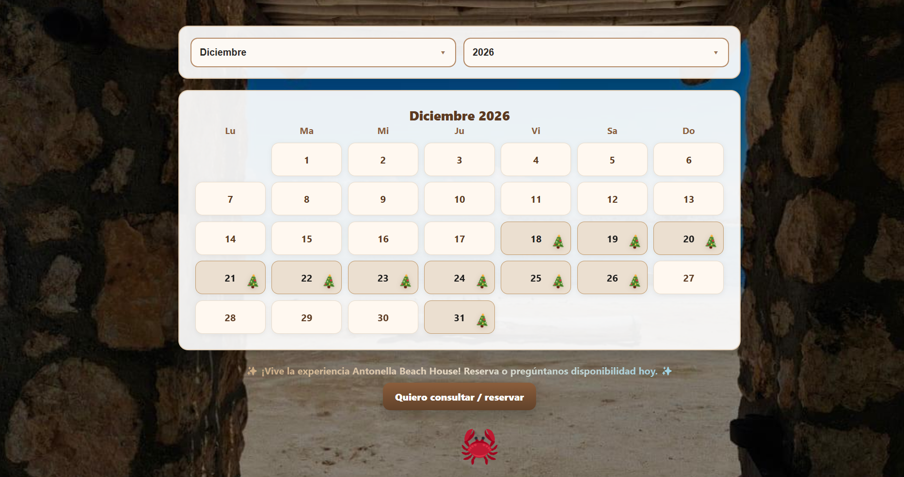

# 🦀 Calendario de Disponibilidad — Antonella Beach House

Calendario web interactivo para consultar la disponibilidad de **Antonella Beach House**. Permite elegir mes y año, ver los días reservados/especiales (🎄) y contactar directamente para consultar o reservar.

🌐 **Demo en vivo:** [calendarioantonellabeachhouse.netlify.app](https://calendarioantonellabeachhouse.netlify.app/)



## ✨ Características

- Selector de **mes** y **año**.
- Calendario mensual (Lu–Do) con días destacados y marcas festivas.
- Botón **"Quiero consultar / reservar"** para contacto directo.
- Diseño elegante con fondo de playa y tonos cálidos.
- Adaptable a distintos tamaños de pantalla.

## 🛠️ Tecnologías

- HTML5
- CSS3
- JavaScript (vanilla)
- Desplegado en Netlify

## 📁 Estructura

```
├── index.html     # Estructura de la página
├── styles.css     # Estilos
├── script.js      # Lógica de la página
├── calendar.js    # Generación del calendario
├── FONDO/         # Imágenes de fondo
└── img/           # Capturas para el README
```

## 🚀 Uso local

Clona el repositorio y abre `index.html` en tu navegador:

```bash
git clone https://github.com/Felixpuntojs/CALENDARIO-MUESTRA.git
```

## 👤 Autor

[Felixpuntojs](https://github.com/Felixpuntojs)
